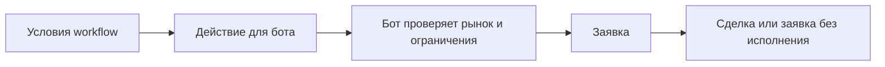

# Как разбирать и улучшать стратегию с помощью ИИ

Это краткое руководство для человека, который подключается к работе над стратегией. Для начала достаточно прислать ИИ скриншот и, если он есть, номер запуска backtest. Пользователю не нужно знать программирование, искать код, собирать журналы или разбираться в настройках: ИИ сам проверит доступные данные и объяснит результат простыми словами.

## Как начать

Пришлите скриншот ситуации. ID или ссылку на backtest run можно добавить, если они под рукой, но это необязательно. Если по картинке неясно, какой вход вы считаете хорошим, добавьте одну фразу.

Дальше ИИ сам находит доступные сведения о запуске и правилах workflow, проверяет работу бота и определяет, где остановился вход. Если вы просите улучшить стратегию, ИИ вносит изменение, готовит тестовую версию, проверяет её на исторических данных и готовит отчёт по-русски. Вам не нужно присылать код, метрики, настройки или разбирать технические условия. Тестовая версия не подключается к работающему боту.

Если данных в доступных источниках не хватит или нельзя понять, какой вход ожидался, ИИ спросит только о конкретно недостающей информации.

## Workflow и бот — разные части

Workflow — это настроенные в платформе условия и действия. Когда нужное условие срабатывает, workflow передаёт действие боту. ИИ проверяет настройки workflow и, если доступно, историю его фактических запусков. Backtest бота эту историю не воспроизводит.

Полученное действие само по себе не обязательно означает «открыть сделку». Например, команда запуска включает работу стратегии и задаёт направление, а бот затем отдельно оценивает рынок и проверяет, разрешён ли вход. Он также учитывает открытую позицию, размер риска и возможность разместить заявку. Даже размещённая заявка может не исполниться.

Поэтому успешное срабатывание workflow ещё не гарантирует сделку. Между workflow и открытой позицией есть отдельные проверки бота, а после них — исполнение заявки.

В стратегии есть правила для движения в тренде и для движения внутри диапазона. Они могут ждать дополнительного подтверждения или отклонить вход, даже если на скриншоте ситуация кажется подходящей. При разборе ИИ объясняет, какое правило повлияло на решение, без необходимости изучать технические детали.

Некоторые workflow могут учитывать сведения о состоянии бота. ИИ проверит, использует ли конкретный workflow такие сведения и как они связаны с его условиями. Сам факт передачи отчёта от бота не подтверждает, что сделка открыта.

## Как ИИ разбирает, почему бот не открыл сделку

ИИ использует скриншот и, если его прислали, номер запуска, чтобы найти нужный момент. Историю workflow и backtest бота он рассматривает отдельно:

1. **Workflow:** сработало ли нужное условие и какое действие он передал боту.
2. **Решение бота:** что бот увидел после получения действия и почему разрешил вход, подождал или отказал. Краткие записи о работе бота называются журналом или debug; пользователю не нужно читать их самостоятельно. Их можно проверить в журнале реального запуска или в backtest бота.
3. **Заявка:** создал ли бот заявку и что с ней произошло — она исполнилась, ожидала исполнения, была отменена или истекла.
4. **Позиция:** открылась ли сделка и оставалась ли другая позиция открытой в этот момент.

Эти результаты указывают на разные причины. Если workflow не сработал, надо разбираться с его условием. Если workflow передал действие, но бот не создал заявку, надо проверять правила входа или ограничения бота. Если заявка была, но сделки нет, причина может быть в её исполнении, а не в обнаружении ситуации.

ИИ сверяет журнал, заявки, позиции и настройки с версией стратегии, которая работала в этом запуске. Если доступные данные не показывают причину, ИИ должен сказать, чего именно не хватает, а не угадывать. Пользователю достаточно получить объяснение простыми словами и понять, какое изменение предлагается и какие другие входы оно может затронуть.

## Что показывает backtest

Backtest — это проверка бота на исторических рыночных данных. Он показывает, как тестовая версия бота принимала бы решения в заданных условиях. Backtest не запускает и не воспроизводит внешний workflow, поэтому не может доказать, сработало бы его условие или какое действие он отправил бы боту. Это не сделка на реальном рынке и не гарантия будущего результата.

Workflow ИИ проверяет отдельно: читает его настройки и, если доступны, сведения о фактических запусках. Если менялись правила workflow, в отчёте нужно прямо указать, что backtest проверил только работу бота и не проверял изменение workflow. Такой запуск подтверждает лишь поведение бота после получения тестовой команды.

ИИ сравнивает исходную и тестовую версии на одном символе и одном периоде, с одинаковыми настройками торговли. Так проще понять, повлияло ли именно изменение на результат. Если одновременно отличаются период, направление или настройки, сравнение может быть нечестным; ИИ должен заметить различия и объяснить их.

Важно проверить не только всю сумму в отчёте, но и исходный пример со скриншота: открылся ли ожидаемый вход, когда именно он появился и не добавились ли нежелательные сделки в других местах того же периода. Также нужно убедиться, что обе версии получили сопоставимый объём исторических данных. Если в запуске не хватает истории или журнала бота, это указывается в отчёте.

ИИ объясняет основные показатели, если они доступны в конкретном backtest. Если какого-то числа нет, он отмечает это, а не подменяет его предположением:

- сколько раз стратегия обнаружила ситуацию, создала заявку и открыла сделку;
- сколько позиций завершилось с прибылью и сколько — с убытком;
- **прибыль до комиссий**, **комиссии** и **итог после комиссий**;
- **максимальную просадку** — самое большое падение результата от предыдущего максимума;
- сколько заявок ожидало исполнения и сколько позиций оставалось открыто в конце теста.

Главная проверка для пропущенного входа — не только итоговая прибыль, а то, прошёл ли нужный пример через workflow и бота и не стало ли больше плохих входов.

## Пример сообщения

Можно написать:

> Проверь эту ситуацию и улучши стратегию, чтобы бот мог открыть такой вход. Сам найди нужные сведения о запуске и правилах, выясни причину и исправь её. Проверь тестовую версию бота на сопоставимом историческом периоде и расскажи по-русски, что изменилось и что показал тест. Если причина связана с workflow, проверь его настройки и фактические запуски отдельно: backtest бота workflow не проверяет. Не проси меня разбираться в коде или искать технические данные. Если чего-то важного нельзя узнать из скриншота и доступных данных, спроси только об этом. Не подключай тестовую версию к работающему боту.

Если пользователь хочет сначала только обсудить идею, он может сказать об этом отдельно. ИИ должен объяснить найденную причину простыми словами, показать ожидаемое изменение и риски. Если пользователь просит реализовать улучшение и ожидаемое поведение понятно, ИИ продолжает работу с исходным кодом без просьбы к пользователю самому подтвердить каждую техническую правку.

Разговор и итоговый отчёт могут быть на русском. Пользователю достаточно объяснить, почему показанный случай считается подходящим; технический поиск, проверка условий и работа с кодом — задача ИИ.

## Как обсуждать результат

Один удачный пример или хороший результат за короткий период не доказывает, что изменение улучшило стратегию. ИИ должен объяснить результат на исходной ситуации и на всём сопоставимом периоде, назвать новые нежелательные входы и оставшиеся вопросы. После этого можно вместе решить, какое следующее изменение проверить.
