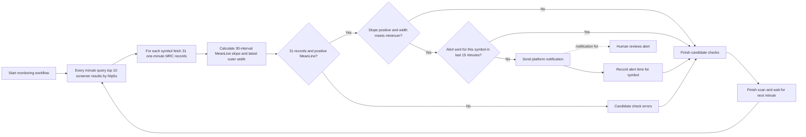

# NTP MRC Activity Monitor — Pre-release v6

This guide explains the scan and notification path of the active platform
workflow `ntp_mrc_activity_monitor_stable_v6`, attached to Structural scalping
version 6 (platform strategy version 127).

## Workflow



The human-review link shows what the notification is for; the workflow does
not wait for a review before continuing its scheduled scans.

## Start and schedule

The platform action `ntp_mrc_activity_monitor.start` initializes the workflow
and its per-symbol alert cooldown map. The scheduler then runs at second 0 of
every minute in `Asia/Bangkok` (`0 * * * * *`). The start action starts this
monitoring workflow; this guide covers its market scan and notifications.

The monitor accepts `min_mrc_distance_pct`. It defaults to `5` and cannot be
negative. The workflow carries this value through the scheduled scans.

## How it chooses symbols

At each scan, `prepare_screener` builds a request for page 1 with 10 results,
sorted by `Ntp5s` in descending order. `top_ntp` runs that request against the
platform screener. The workflow checks every returned `symbol_key`, carrying
its `ntp_5s` activity value into the next step. The request has no additional
filter expression, so the candidates are the screener's ten highest-ranked
results at that time.

## What it fetches for each symbol

For each candidate, the workflow requests page 1 of 31 records at timeframe
`60` seconds. It requests these outputs from the 200-period `mrc` indicator:

- `MeanLine`
- `UpBig`
- `DownBig`

The records are returned newest first. `ntp_5s` is carried along as activity
context for the alert. This workflow's market-analysis path uses one-minute
MRC values; it does not request five-minute MRC or a volume indicator.

## How it decides whether to alert

The classification node reads `MeanLine`, `UpBig`, and `DownBig` from the
newest record, and `MeanLine` from the oldest of the 31 records. It computes
the average change in the mean line across the 30 intervals:

```text
slope = (newest MeanLine - oldest MeanLine) / 30
```

It measures the current outer-channel width relative to the mean line:

```text
outer_width_pct = (newest UpBig - newest DownBig) / newest MeanLine * 100
```

The workflow labels the slope `up`, `down`, or `flat` according to its sign.
It makes an alert candidate only when **both** conditions are true:

1. `slope > 0` (the MRC mean line is rising);
2. `outer_width_pct >= min_mrc_distance_pct` (the channel is wide enough).

With the default setting, the channel width must be at least 5% of the mean
line. Although the code labels downward and flat slopes, those states do not
create alert candidates.

The check returns an error instead of classifying the symbol when fewer than
31 records are available or the newest `MeanLine` is zero or negative.

## Platform notification and cooldown

For an eligible candidate outside its cooldown, the workflow calls the
platform's `alert.info` notification with this message:

```text
NTP5S activity=<ntp_5s> symbol=<symbol_key> MRC 30-bar direction=<direction> slope=<slope> outer width=<outer_width_pct>%
```

After an alert, the workflow records its timestamp under
`last_alert:<symbol_key>`. It suppresses another alert for that symbol while
less than 900,000 milliseconds (15 minutes) have elapsed. The cooldown map is
initialized when the workflow starts and carried through its scheduled scans.

This document covers the selected workflow's screener, one-minute MRC check,
and platform notification path.
